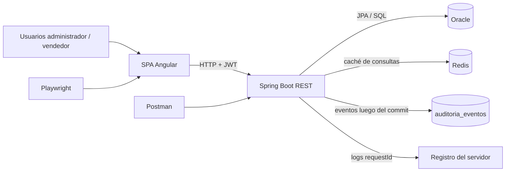

# Arquitectura PharmaSoft

**Exportación pendiente:** convertir el diagrama a PNG con Mermaid Live y guardarlo como `docs/arquitectura.png`. Los componentes de Redis y los logs deben contrastarse con la configuración actual.
