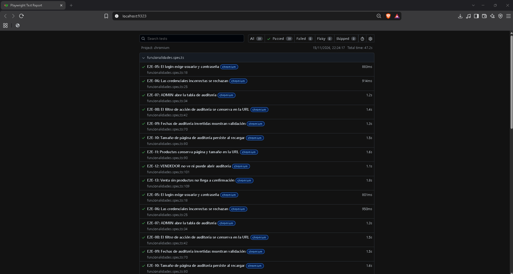
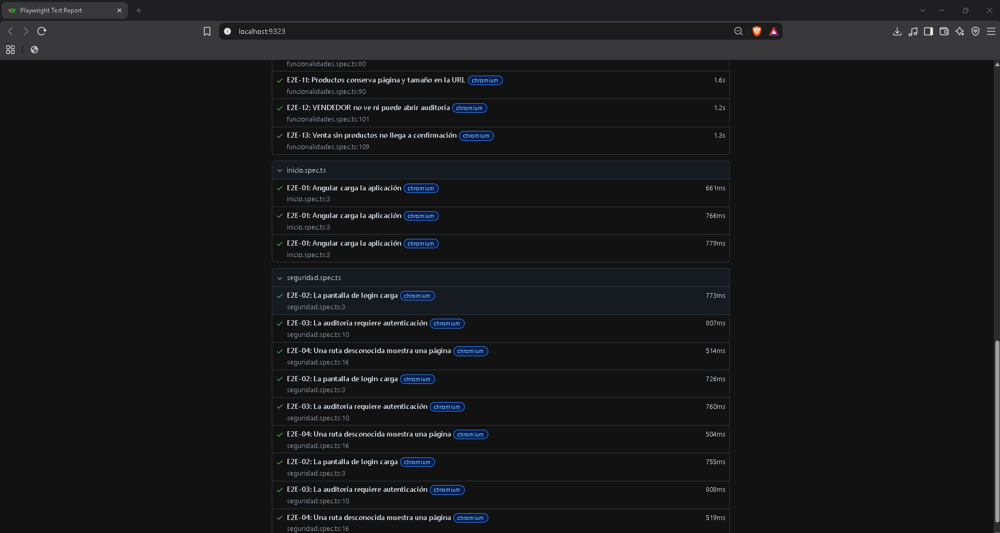

# Resultados de pruebas — Sesión 14

**Proyecto:** PharmaSoft  
**Estudiante:** Josias Pari Mamani  
**Fecha de ejecución:** 15 de noviembre de 2026 (hora local, según reporte HTML)  
**Repositorio:** `pharma-frontend`  
**HEAD local consultado:** `78198ce`  
**Importante:** esta referencia identifica el HEAD al momento de la consulta. Las pruebas y configuración nuevas figuraban sin seguimiento o sin confirmar en Git; debe actualizarse con el commit que efectivamente incorpore esta suite.

## Entorno

- Frontend: Angular; servidor local `http://localhost:4200`.
- Backend: Spring Boot y Oracle; Redis en Docker.
- Ejecutor: `@playwright/test`, navegador Chromium.
- Configuración: `workers: 1`, `retries: 0`.
- Comando: `npx playwright test --repeat-each=3 --reporter=list,html`.

## Ejecución de estabilidad

| Indicador | Resultado |
|---|---:|
| Pruebas distintas | 13 |
| Repeticiones por prueba | 3 |
| Ejecuciones totales | 39 |
| Aprobadas | 39 |
| Fallidas | 0 |
| Flaky informadas por Playwright | 0 |
| Omitidas | 0 |
| Duración total | 47,2 s |

La suite verificó carga de la aplicación, formulario de login, rechazo de credenciales incorrectas, acceso y filtros de auditoría, persistencia de parámetros de URL y paginación, permisos del vendedor y validación de venta sin productos.

### Evidencias

*Figura 1. Resumen del informe HTML. El contador muestra 39 pruebas aprobadas, 0 fallidas y 0 intermitentes, con tiempo total de 47,2 segundos.*

*Figura 2. Detalle de las ejecuciones de `inicio.spec.ts` y `seguridad.spec.ts` y su estado satisfactorio.*

## Incidencia detectada y corregida

En una ejecución anterior de tres repeticiones, la prueba **E2E-08, filtro de acción de auditoría**, terminó por tiempo de espera y el resultado fue **38 aprobadas y 1 fallida**. La prueba recorría las filas utilizando un conteo y luego índices; durante la actualización asíncrona de la tabla, intentó leer una fila que ya no estaba disponible. Se modificó la verificación para esperar explícitamente el evento filtrado y validar la ausencia de filas ajenas al filtro sin iterar por índices. En la ejecución posterior, las **39 verificaciones aprobaron**. Registrar también esta incidencia en `docs/incidencias.md` junto con el commit de la corrección.

## Otras verificaciones pendientes de incorporar

Los resultados anteriores **no equivalen** a evidencias de registro exitoso de venta, descuento de stock, trazabilidad con `requestId` o prueba de token alterado: esas verificaciones requieren sus propias pruebas y evidencias. El reporte debe complementarse con los casos HTTP de Postman y la trazabilidad de una venta confirmada.
